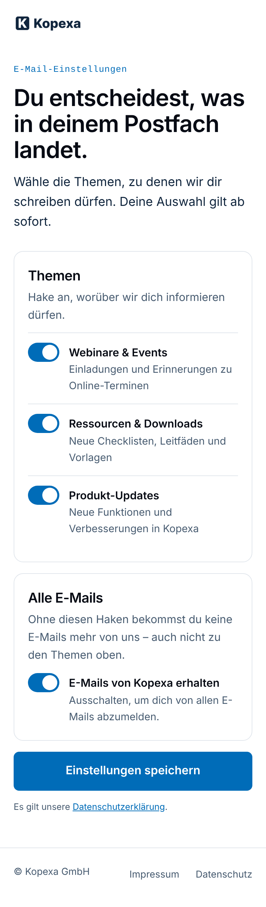
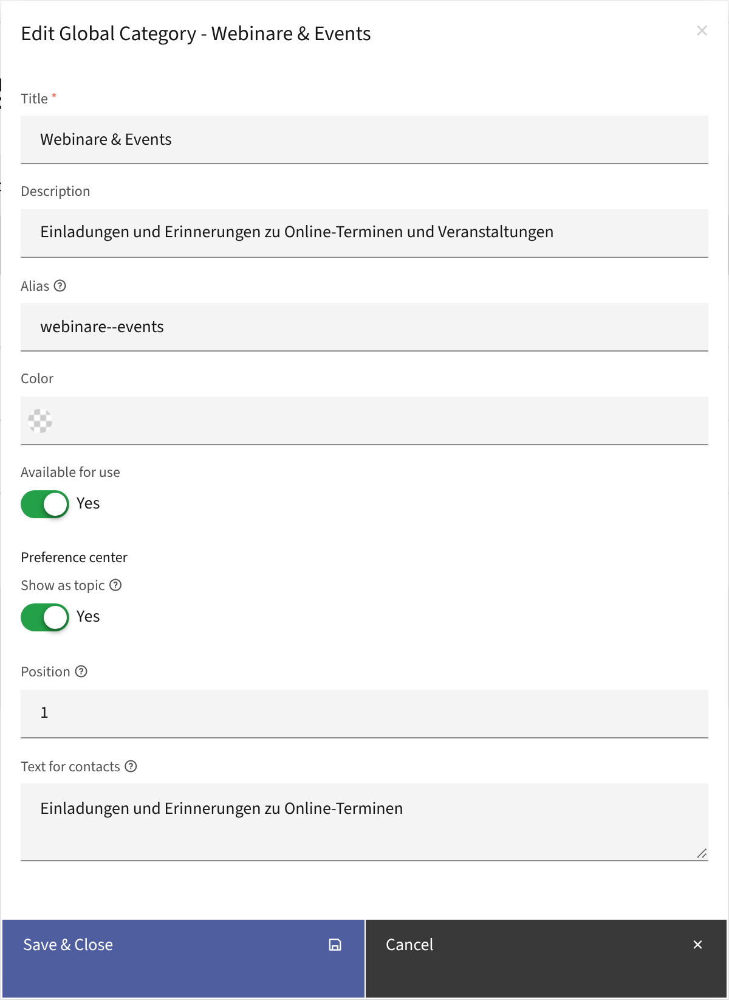
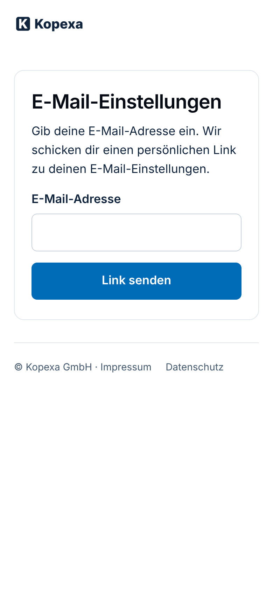
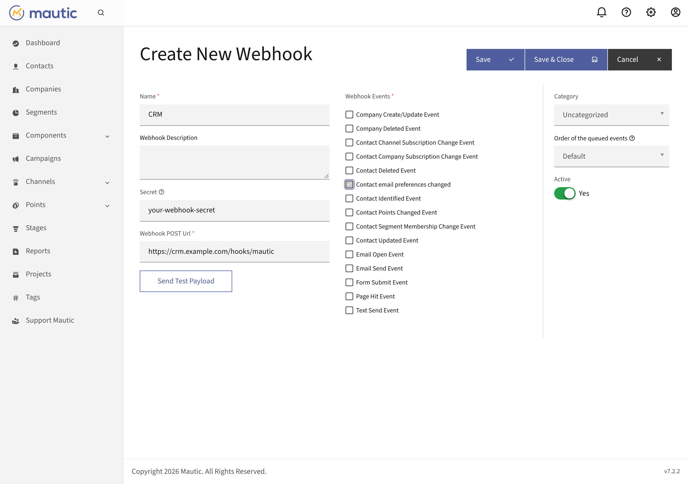

# Preferences Center for Mautic

A Mautic 7 plugin that turns Mautic's preference center into one people
can be given:

- **Topics you choose.** Mautic shows every published category on the
  preference page. With this plugin each category has *Show as topic*, a
  *Position* and a *Text for contacts* (Components → Categories, the
  categories API, or setup as code).
- **Hidden topics stay as they were.** Mautic treats every category missing
  from the saved form as switched off. Without this plugin, hiding a
  category from the page would unsubscribe everyone who saves the page from
  it. The plugin keeps the contact's state for every topic they did not see.
- **Webhooks for other systems.** A webhook event *Contact email
  preferences changed* in Mautic's webhooks: one message per contact with
  what changed (topics, all emails) and the current state, from the
  preference page, one-click unsubscribe, re-subscribe, the admin or the API.
- **A link by email.** Without an email at hand (e.g. a link on your
  website), people enter their address at `/email/preferences` and get a
  personal link to their preferences. Only who reads the mailbox gets in.
- **Test emails show the real page too.** Links of emails sent without
  statistics (*Send example*, test sends) open Mautic's plain built-in form;
  the plugin sends them to the preference page like any other email.
- **Setup as code.** `preferences-center:sync` creates the topics, the
  preference page and Mautic's unsubscribe settings from a JSON declaration;
  idempotent, for every deploy.

The look of the page comes from your theme; the plugin ships none (see
[Themes](#themes)).

<p>
  
  &nbsp;
  
</p>

*Left: the preference page contacts open from an email (here in the
[Kopexa theme](https://github.com/kopexa-grc/mautic-stack/tree/main/image/extensions/mautic-theme-kopexa-preferences));
the plugin decides which topics appear, in which order and with which text.
Right: the settings per category in Mautic.*

## Install

```bash
composer require kopexa/mautic-preferences-center
php bin/console mautic:plugins:reload
```

Requires Mautic 7.2+ and PHP 8.4+. The plugin creates its table
(`preferences_center_topics`) on first use and changes no Mautic table.
It loads nothing from other hosts: no fonts, scripts or images (the page
is styled by your theme).

## Topics

Topics are Mautic categories of the bundles *global* and *email*. An email
carries one category; contacts who switched that topic off do not get
campaign or segment emails of that category. Emails without a category
reach everyone who has not unsubscribed from all emails, so give every
marketing email its category.

In *Components → Categories*, each category has a section *Preference
center*:

| Field | Effect |
|---|---|
| Show as topic | On the preference page or not. Default: shown (Mautic's behaviour). |
| Position | Order on the page, lowest first. Without one: after the others, by name. |
| Text for contacts | Under the topic name, e.g. which emails and how often. |

The same through the API:

```bash
curl -u user:pass -X PATCH https://mautic.example.com/api/categories/5/edit \
  -H 'Content-Type: application/json' \
  -d '{"preferencesCenter": {"visible": true, "position": 2, "text": "New features, once a month"}}'
```

Requests without `preferencesCenter` leave the settings alone.

## Link by email

`https://<mautic>/email/preferences` asks for an email address and sends a
personal link to the preference page, for a link on a website ("Email
preferences") or when someone deleted all your emails.

- **Same answer for every address.** Whether a contact has it or not, the
  page says "If this address is on our list, we have just sent you a
  link", so nobody can find out who is on your list. Unknown addresses get
  no email, and no contact is created.
- **Limits:** 3 requests per address and 10 per IP address within an hour
  (`preferences_center_rate_email`, `preferences_center_rate_ip`), counted
  for unknown addresses too and stored as hashes only. A CSRF token and a
  hidden field keep simple bots out.
- **The email** is a Mautic email, *Preferences center: link*, created on
  first use (text in `preferences_center_locale`, button colour
  `preferences_center_button_color`). Edit it in Mautic like any email, or
  set `preferences_center_link_email` to the ID of your own; it needs
  `{unsubscribe_url}`, the personal link. It goes out as a requested
  service email: also to contacts who unsubscribed from all emails, so they
  can come back.
- **The default preference page** opened at its own address (e.g.
  `/preferences`) knows no contact; such visits are sent to
  `/email/preferences` (off: `preferences_center_page_redirect: false`).
  Personal links and the builder preview are not affected.
- The form uses the message layout of your system theme
  (`html/message.html.twig`, like Mautic's unsubscribe pages) with the
  classes `pc-request`, `pc-request-input`, `pc-request-button`,
  `pc-request-error`. Texts in English and German (`de`).

<p></p>

## Webhooks

In *Settings → Webhooks*, create a webhook with the event *Contact email
preferences changed* (`kopexa.preferences_center.preferences_changed`),
the URL of the receiving system and a secret. Mautic sends, retries and
logs it like its own webhooks.



Example body:

```json
{
  "kopexa.preferences_center.preferences_changed": [
    {
      "contact": {"id": 23, "email": "jane@example.com"},
      "source": "preference_center",
      "changes": {
        "topics": [{"id": 1, "name": "Webinars", "subscribed": false}]
      },
      "current": {
        "emails": true,
        "topics_subscribed": [{"id": 3, "name": "Product updates"}],
        "topics_unsubscribed": [{"id": 1, "name": "Webinars"}]
      },
      "timestamp": "2026-11-05T12:45:06+00:00"
    }
  ]
}
```

- `changes.topics`: topics switched on or off; `changes.emails`: all emails
  on or off (`{"subscribed": false, "reason": "unsubscribed"}`), only when
  that changed.
- `current`: the state afterwards, all topics including hidden ones.
- `source`: `preference_center`, `one_click_unsubscribe` (List-Unsubscribe),
  `resubscribe`, `admin`, `api` or `system` (console, campaigns).
- Only real changes are sent; saving the page unchanged sends nothing. One
  message per contact per request, sent after the response.
- **Signature:** header `Webhook-Signature` is the Base64 HMAC-SHA256 of
  the body with the webhook's secret. Check it before trusting the message:

  ```php
  hash_equals(base64_encode(hash_hmac('sha256', $body, $secret, true)), $signature)
  ```

- **Receivers in a private network** (e.g. a service in the same cluster):
  Mautic refuses private addresses for webhooks unless they are listed in
  *Configuration → Webhook Settings → Allowed private addresses*
  (`webhook_allowed_private_addresses`).
- With *queue mode* `command_process`, messages are sent by
  `mautic:webhooks:process` (cron) instead of right away.

## Setup as code

```bash
php bin/console preferences-center:sync --file preferences.json   # or --json '…'
php bin/console preferences-center:sync --file preferences.json --dry-run
```

```json
{
  "topics": [
    {"name": "Webinars", "text": "Invitations to online events"},
    {"name": "Resources", "text": "New checklists and guides"},
    {"name": "Product updates", "text": "New features, once a month"}
  ],
  "hideOtherTopics": true,
  "page": {"alias": "preferences", "title": "Email preferences", "theme": "my-preferences-theme"},
  "frequency": false,
  "pauseDates": false,
  "systemTheme": "my-theme",
  "linkRequest": {"locale": "de", "buttonColor": "#006CB8", "email": "My link email", "redirect": true}
}
```

| Key | Effect |
|---|---|
| `topics` | Global categories matched by name; missing ones are created. Shown (unless `"visible": false`), in this order, with `text`. Other settings of the categories stay. |
| `hideOtherTopics` | Hide every other category from the page (they are not changed otherwise). |
| `page` | Optional. The preference page by `alias`, created once from `theme` (required; its page template must contain `{categorylist}` and `{saveprefsbutton}`), marked as preference center and published. Afterwards it is edited in Mautic; `"updateContent": true` re-creates its content from the theme. `language` only with an installed Mautic language. |
| `frequency`, `pauseDates` | Also offer "fewer emails" / a pause. Default off. |
| `systemTheme` | Theme of Mautic's system pages (unsubscribed, re-subscribed). |
| `linkRequest` | Optional. The link by email: `locale` of page and email, `buttonColor` of the default email, `email` (name or ID of your own link email, must contain `{unsubscribe_url}`), `redirect` from the preference page (default true). |

It also sets Mautic's unsubscribe settings: show the preferences with the
topics (not segments), the page as default preference center for all
emails. Nothing is written when everything matches (`unchanged`). An
invalid declaration changes nothing and lists every error.

## Themes

Mautic renders the preference page from the theme's page template with the
tokens `{categorylist}`, `{channelfrequency}`, `{saveprefsbutton}` and
`{successmessage}`. With this plugin each topic in `{categorylist}` is:

```html
<input type="checkbox" name="lead_contact_frequency_rules[global_categories][]" value="1" data-topic-id="1">
<label for="…"><span class="pref-topic-name">Webinars</span> <span class="pref-topic-text">Invitations to online events</span></label>
```

so a theme can style `.pref-topic-name` and `.pref-topic-text`.
The unsubscribe and re-subscribe confirmations use the theme's
`html/message.html.twig`.

## Tests

- `bin/check.sh`: syntax, composer.json, versions, `Tests/selftest.php`
  (topic order).
- `tests/functional/run.sh`: a real Mautic 7 (CI: Composer project,
  MariaDB, PHP 8.4 and 8.5) with this plugin. Sync (creation, second run
  unchanged, validation), page (shown topics, order, text), link by email
  (same answer, email with a working link, limits, token), saving
  (hidden topics stay on), webhooks (payload, source, signature, nothing on
  no change, one-click unsubscribe, re-subscribe), the category form and
  the API.

## License

Apache-2.0
